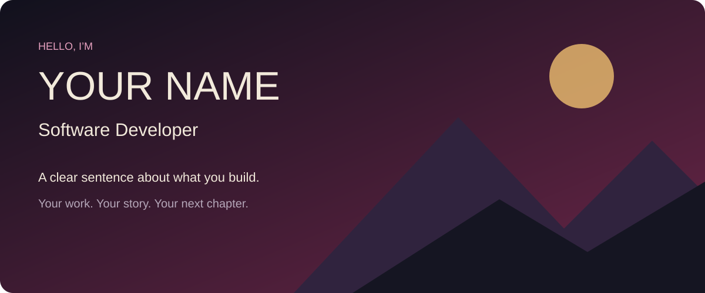
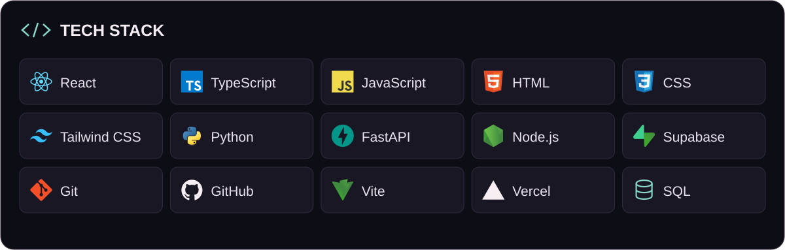

**Your name** · Software Developer

Write two short sentences about what you build and who it helps. Use only information you can support with real work.

[Portfolio](https://example.com) · [LinkedIn](https://www.linkedin.com/in/YOUR-USERNAME) · [Email](mailto:you@example.com)

### Tech stack

<picture>
  <source media="(max-width:640px)" srcset="assets/tech-stack-mobile.svg">
  
</picture>

<!-- This is a sample stack. Remove tools you do not use and update the image alt text. -->

### Selected work

| Project | What it does | Explore |
| --- | --- | --- |
| Your first project | The problem, what you built and its current status. | [Source](https://github.com/YOUR-USERNAME/YOUR-REPO) |
| Your second project | One useful feature and your specific contribution. | [Source](https://github.com/YOUR-USERNAME/YOUR-REPO) |
| Your third project | Label personal demos and unfinished work accurately. | [Source](https://github.com/YOUR-USERNAME/YOUR-REPO) |

### About me

Add your confirmed education, current work and relevant community roles here. Remove this section if you prefer.

[Contact me](mailto:you@example.com)
